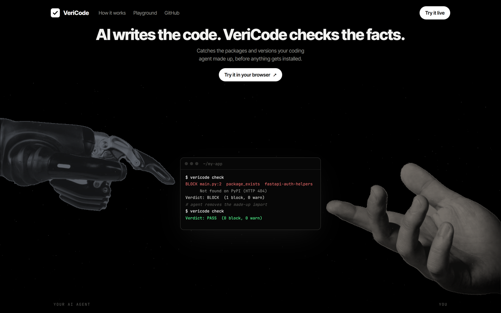
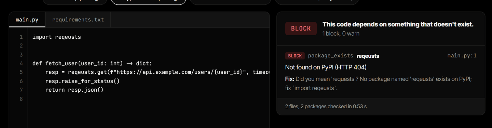

# VeriCode

**AI writes the code. VeriCode checks the facts.**

VeriCode catches the packages and versions your AI coding agent made up, before anything gets
installed, and tells the agent exactly how to fix them.

[**Try it in your browser**](https://veri-code.web.app) ·
[Demo video](https://drive.google.com/file/d/1T9lAoHF-13nIzrMPdOuR7L7W61f0nXo3/view?usp=sharing) ·
[Benchmark results](benchmark/RESULTS.md)



## The problem

AI coding agents sometimes write code that depends on things that don't exist:

```python
from fastapi_auth_helpers import require_api_key   # no such package
```
```text
requests==99.0.0                                    # no such version
```

This happens a lot. In a study of 576,000 code samples from 16 models, at least **5.2%** of the
packages suggested by commercial models, and **21.7%** for open-source models, did not exist
([Spracklen et al., USENIX Security 2025](https://arxiv.org/abs/2406.10279)). Attackers know this:
they register those invented names on PyPI with malware inside and wait for someone to
`pip install` them. This is called *slopsquatting*.

## What VeriCode does

After the agent changes imports or dependency files, VeriCode checks every package and pinned
version against PyPI and returns one verdict:

| Verdict | Meaning | What the agent should do |
|---|---|---|
| `BLOCK` | Something doesn't exist (package or version) | Fix it using the hint, then check again |
| `WARN` | Real, but risky or couldn't be verified | Tell the user |
| `PASS` | Every package and version is real | Done |

Each finding names the file, the line and a fix:

```text
$ vericode check
BLOCK main.py:2  package_exists  fastapi-auth-helpers: Not found on PyPI (HTTP 404)
      -> Remove `from fastapi_auth_helpers import require_api_key`: no package named
         'fastapi-auth-helpers' exists on PyPI. Use a real package or write the code without it.

Verdict: BLOCK  (1 block, 0 warn | 2 files, 2 packages | 0.25s)
```

The agent fixes its own code, checks again, gets `PASS`, and only then says it's done.

### What it checks

| Check | Example | Result |
|---|---|---|
| Package doesn't exist | `import fastapi_auth_helpers` | BLOCK |
| Typo of a real package | `import reqeusts` | BLOCK, *"Did you mean 'requests'?"* |
| Version never released | `requests==99.0.0` | BLOCK, *"Latest release is 2.34.2"* |
| Version yanked | a pin to a withdrawn release | WARN |
| Lookalike or risky package | brand new (< 30 days), < 1,000 downloads/month, one release, no links | WARN |
| Used but not declared | imported, but missing from `requirements.txt` / `pyproject.toml` | WARN |

It reads `import` statements, `requirements*.txt`, `pyproject.toml` (including optional
dependencies, dependency groups and Poetry) and understands names that differ between import and
install: `cv2` is `opencv-python`, `PIL` is `Pillow`, `google.cloud.storage` is
`google-cloud-storage` (about 200 of these are built in). It never flags the standard library,
your own modules, or optional imports inside `try/except ImportError`.

## Try it

### In the browser (no install)

Open **[veri-code.web.app](https://veri-code.web.app)**, pick an example or paste your own code,
and press **Check**. It runs entirely in your browser; your code is not uploaded anywhere.



### On your machine

Needs Python 3.11 or newer.

```bash
pip install git+https://github.com/SAM389/veri_code
```

```bash
vericode check                         # check the project in the current folder
vericode check --root path/to/project  # or another folder
git diff HEAD | vericode check --diff -   # only the lines that were just added
vericode check --format json           # machine-readable output
```

Exit codes: `0` = OK, `1` = the verdict reached `--fail-on` (default `block`; use
`--fail-on warn` to be stricter), `3` = VeriCode itself failed. That makes it easy to use in CI
or a pre-commit hook.

## Use it with your AI agent

The best way to use VeriCode is to let the agent call it itself, right after it edits code.

### As an MCP tool

VeriCode ships an [MCP](https://modelcontextprotocol.io) server, `vericode-mcp`, with two tools:

- `verify_change(root, diff?)`: checks a project on disk (or just a `git diff` of it).
- `verify_files(files, diff?)`: checks files sent as text (for a remote server).

Add it to any MCP client. For example:

```bash
claude mcp add vericode -- vericode-mcp      # Claude Code
```

```json
{
  "mcpServers": {
    "vericode": { "command": "vericode-mcp" }
  }
}
```

The server tells the agent what to do with each verdict (fix every BLOCK, then call it again).
To run it over HTTP instead: `vericode-mcp --transport http --port 8080` (endpoint `/mcp`,
health check `/health`; only `verify_files` is exposed there).

### As an Agent Skill

Copy [`.agents/skills/vericode-verify`](.agents/skills/vericode-verify) into your project's
`.agents/skills/` folder. Agents that support [Agent Skills](https://agentskills.io) (for example
Google Antigravity) then run VeriCode on their own after changing imports, fix every BLOCK (up to 3
rounds), and never `pip install` a package just to test whether it exists.

## Configuration (optional)

Create `.vericode/config.yaml` in your project:

```yaml
allow: [acme-internal, acme_utils]   # private packages: never looked up, never reported
ignore_paths: ["scripts/*", "legacy/"]
```

Allowlisted names are never sent to PyPI, so private package names stay private.

## How it works

```text
your code ──► extract ──► resolve ──► look up ──► judge ──► PASS / WARN / BLOCK + fix hints
              imports,    import name  PyPI JSON   exists? version?
              dep files   → package    API (cached) typo? risk?
```

1. **Extract:** reads imports with Python's own parser (`ast`) and dependency files with
   `tomllib`.
2. **Resolve:** turns each import into a PyPI package name and skips the standard library,
   local modules and allowlisted names.
3. **Look up:** asks the PyPI JSON API (in parallel, cached for 24 hours) and pypistats.org for
   download counts.
4. **Judge:** decides BLOCK / WARN / PASS and writes a fix hint.

Design rules:

- **Facts, not guesses.** No LLM decides whether a package exists. Every reason comes from PyPI,
  pypistats or the parser.
- **Fail open.** If PyPI can't be reached, the result is `WARN: could not verify`, never a false
  `BLOCK`.
- **Private by default.** Only package names leave your machine; your code never does. VeriCode
  never installs anything.

## Results

On a 20-case benchmark (10 planted mistakes, 10 clean projects with tricky names), run against
live PyPI:

| Metric | Result |
|---|---|
| Planted made-up packages, typos and fake versions caught | **10 / 10** |
| False alarms on clean code (any WARN or BLOCK) | **0 / 10** |
| Median check time, first run / cached | **0.46 s / 0.015 s** |

Details per case are in [`benchmark/RESULTS.md`](benchmark/RESULTS.md). Run it yourself with
`python benchmark/run.py` (needs internet). It is a small, self-built set, so treat it as a sanity
check rather than a final score.

## Limitations and roadmap

- **Python and PyPI only** for now. npm / TypeScript is next.
- **Made-up functions inside real packages** (`requests.get_json()`) are not caught yet. Planned:
  type-check the change with pyright in a sandbox that only installs already-verified packages.
- **Not on PyPI yet**: install from GitHub as shown above.
- Planned: a GitHub Action and pre-commit hook, and a hosted MCP endpoint.

## Development

```bash
uv venv --python 3.11 && uv pip install -e ".[dev]"
pytest                                  # offline test suite
ruff check . && ruff format --check .   # lint
vericode check --root tests/fixtures/fake_import   # should print BLOCK
```

[`AGENTS.md`](AGENTS.md) explains the code layout, the data flow and where to change what.
The web playground lives in [`web/`](web) and the benchmark in [`benchmark/`](benchmark).

## License

Source-available under **MIT + [Commons Clause](https://commonsclause.com/)**. See
[`LICENSE`](LICENSE).

You may use, modify and share VeriCode freely, including at work. You may **not** sell it, or sell
a product, hosted service or paid support whose value comes mainly from VeriCode, without written
permission from the author. For a commercial license, open an issue or contact the author.
